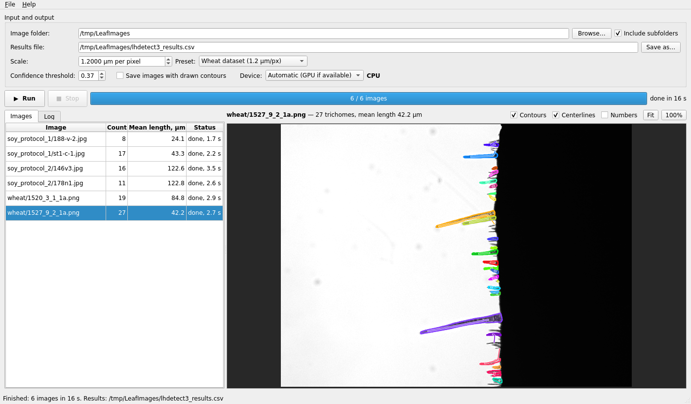

# LHDetect3 desktop application

A program for counting leaf trichomes and measuring their lengths in images of soybean and wheat leaf folds. It runs the RF-DETR-Seg Small model from this repository (converted to ONNX) and works on Windows, Linux and macOS.



For a folder of images, the program writes a table with the number of trichomes on every image and their lengths. Given the image scale (micrometers per pixel), all lengths are reported in micrometers. Every detected trichome can be inspected: its contour is drawn in its own color, together with the centerline used to measure the length.

## Windows

Download the installer [`dist/windows/LHDetect3-1.1.0-win64-setup.exe`](dist/windows/) (button *Download raw file*) and run it. No administrator rights are needed; Python and all libraries are included. Windows may show a SmartScreen warning because the installer is not signed: click *More info → Run anyway*.

The program uses the GPU through DirectML (any DirectX 12 graphics card: AMD Radeon, NVIDIA GeForce/RTX, Intel) and falls back to the CPU automatically.

## Linux and macOS

Requirements: Python 3.10–3.13 and Git LFS.

```bash
git lfs install
GIT_LFS_SKIP_SMUDGE=1 git clone https://github.com/genaev/lhdetect3.git   # without the large files
cd lhdetect3
git lfs pull --include "gui/lhdetect3_gui/models/*.onnx"                  # only the model (126 MB)
cd gui
./install.sh            # or ./install.sh --cpu
lhdetect3               # start the program
```

`install.sh` creates a separate environment in `~/.lhdetect3`, installs the program with the ONNX Runtime build for your hardware, adds the commands `lhdetect3` and `lhdetect3-cli` to `~/.local/bin`, a menu entry on Linux and `~/Applications/LHDetect3.app` on macOS, and finally runs a self-test.

| Hardware | ONNX Runtime package chosen by `install.sh` |
|---|---|
| NVIDIA GPU (Linux), driver with CUDA 12 or 13 | `onnxruntime-gpu[cuda,cudnn]` (CUDA and cuDNN libraries are installed with it) |
| AMD GPU (Linux) with ROCm in `/opt/rocm` | `onnxruntime-migraphx` from repo.radeon.com for the installed ROCm version |
| Apple silicon (macOS) | `onnxruntime` (Core ML) |
| anything else | `onnxruntime` (CPU) |

Manual installation in any Python environment:

```bash
pip install ./gui onnxruntime        # or onnxruntime-gpu / onnxruntime-directml
python -m lhdetect3_gui
```

## Using the program

1. **Image folder** — choose the folder with the images (PNG, JPEG, TIFF, BMP; subfolders are included by default).
2. **Scale** — micrometers per pixel of your images, or a preset (Wheat dataset 1.2 µm/px, Soybean protocol 2 3.0 µm/px). With the scale left at 0, lengths are reported in pixels.
3. **Run** — the progress bar shows the processed images and the estimated remaining time. Each row of the results file is written as soon as the image is processed; if the run is interrupted, it can be continued later.
4. Click an image in the list to see the detected trichomes. Each contour has its own color and the thin line is the centerline along which the length is measured. A dashed box marks a trichome that was detected but whose mask is too small to measure: it is counted but has no length. Hover over a trichome to see its length. An image that has not been processed yet is processed when you click it.

Options: the confidence threshold (default 0.37, selected on the validation set), saving images with drawn contours (JPEG, folder `<results file>_annotated`), and the device (automatic or CPU only).

### Results file

```text
image,count,n_measured,mean_length_um,lengths_um
<image path relative to the folder>,<N>,<M>,<mean length>,<length 1>;<length 2>;...;<length M>
```

`count` is the number of detected trichomes; `n_measured` is the number of them whose mask is large enough to measure; `mean_length_um` is their mean length and `lengths_um` all their lengths separated by semicolons (`_px` instead of `_um` without a scale). Counting and length measurement are the same as in [`infer.py`](../infer.py); the length is the length of the mask centerline (see [`centerline.py`](lhdetect3_gui/centerline.py)), which on manually annotated trichomes of the validation set deviates from the true length by 1.1 pixels (2.7%) on average.

### Command line

```bash
lhdetect3-cli /path/to/images --scale 1.2 --output results.csv --annotated annotated/
```

On Windows the same program is `lhdetect3-cli.exe` in the installation folder.

## GPU selection

At the first start, the program tries the GPU back-ends available in the installed ONNX Runtime (CUDA, ROCm/MIGraphX, DirectML, Core ML), runs the bundled reference image on the GPU and on the CPU and uses the GPU only if both give the same detections. The result is remembered; *Device → CPU only* switches the GPU off. If the GPU fails later during processing, the program continues on the CPU.

## For developers

```
gui/
├── lhdetect3_gui/           application package
│   ├── app.py               window (PySide6)
│   ├── engine.py            ONNX Runtime inference, device selection, pre- and post-processing
│   ├── centerline.py        trichome length (same as ../centerline.py)
│   ├── batch.py, cli.py     folder processing, results file, command line
│   ├── viz.py               colors and drawing
│   └── models/              ONNX model (Git LFS) and reference image for the GPU check
├── tools/export_onnx.py     conversion of the PyTorch checkpoint to ONNX with a check against PyTorch
├── packaging/               PyInstaller specification and Windows build (build_windows.ps1, Inno Setup)
├── install.sh               installation for Linux and macOS
└── dist/windows/            Windows installer (Git LFS)
```

The ONNX model is made from `../weights/rfdetrseg_small_wheat_soy.pth` with `tools/export_onnx.py` in an environment with `torch` and `rfdetr==1.5.2` (about 16 GB of RAM). Self-attention over the whole image is exported in chunks, which gives the same result with much less memory. The script compares ONNX Runtime with PyTorch on the example images.

The Windows installer is built on Windows with `packaging\windows\build_windows.ps1` (installs Python 3.12 and Inno Setup with winget if needed, builds with PyInstaller, runs a self-test and creates the installer in `dist\windows`).
